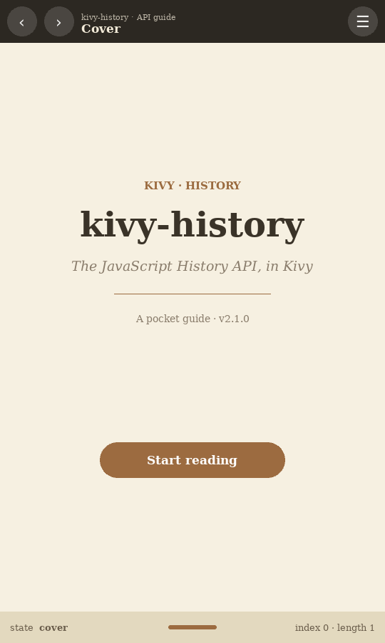

# kivy-history

[](https://github.com/gmork2/kivy-history/actions/workflows/ci.yml)
[](https://pypi.org/project/kivy-history/)
[](https://pypi.org/project/kivy-history/)
[](LICENSE)

**kivy-history** is a [Kivy](https://kivy.org) helper inspired by the
[JavaScript History API](https://developer.mozilla.org/en-US/docs/Web/API/History).
It lets you navigate back and forth through a `ScreenManager` and manipulate the
contents of its history stack.



## Features

- Navigate with `back()`, `forward()` and `go(delta)`.
- Push and replace states with `push_state()` and `replace_state()`.
- Inspect the current `state`, the `stack`, the `index` and the number of
  entries (`lenght`).
- Optional logging of the stack (`HISTORY_LOG=1`).
- No visual dependency beyond a Kivy `ScreenManager` (works with any
  transition).

## Installation

### With `uv` (recommended)

```bash
uv add kivy-history
```

### With `pip`

```bash
pip install kivy-history
```

## Quick start

```python
from kivy.app import App
from kivy.uix.screenmanager import ScreenManager, Screen
from kivy_history import History


class MyApp(App):
    def build(self):
        manager = ScreenManager()
        manager.add_widget(Screen(name="home"))
        manager.add_widget(Screen(name="settings"))
        manager.current = "home"

        manager.history = History()
        # Register screen changes into the history stack.
        manager.bind(current=manager.history.on_state)
        return manager


MyApp().run()
```

Then use `manager.history.back()`, `manager.history.forward()`,
`manager.history.go(-1)`, `manager.history.push_state("screen_name")` or
`manager.history.replace_state(name="screen_name")`.

See [`src/kivy_history/sample.py`](src/kivy_history/sample.py) for a complete
demo. You can also run it after installing the package:

```bash
kivy-history
```

## Development

This project uses [uv](https://docs.astral.sh/uv/) as the package manager while
remaining fully compatible with `pip` (standard PEP 517/621 `pyproject.toml`).

```bash
# Create the environment and install the project in editable mode + dev tools
uv sync --extra dev

# Run the test suite (headless)
uv run pytest

# In a headless environment such as CI, run under a virtual framebuffer:
xvfb-run -a uv run pytest

# Lint and format checks
uv run ruff check .
uv run ruff format --check .

# Build sdist + wheel
uv build
```

With `pip`, install in editable mode with the dev extras:

```bash
pip install -e ".[dev]"
```

## Continuous integration

GitHub Actions runs the lint, test and build steps on every push and pull
request (Python 3.9–3.12). See
[`.github/workflows/ci.yml`](.github/workflows/ci.yml).

## Releasing / deploying to PyPI

Publishing to [PyPI](https://pypi.org/project/kivy-history/) is automated with
GitHub Actions using PyPI *trusted publishing* (OpenID Connect) — no tokens are
stored in the repository.

1. Bump the version in
   [`src/kivy_history/version.py`](src/kivy_history/version.py).
2. Commit and push.
3. Create and push an annotated tag:

   ```bash
   git tag -a v1.0.4 -m "Release v1.0.4"
   git push origin v1.0.4
   ```

Pushing a `v*` tag triggers
[`.github/workflows/publish.yml`](.github/workflows/publish.yml), which builds
the package and publishes it to PyPI.

> **One-time setup:** in PyPI, configure the repository
> `gmork2/kivy-history` as a *trusted publisher*
> (Project → Publishing → Add a new trusted publisher) with the workflow name
> `publish.yml`.

## License

[GPL-3.0](LICENSE)

